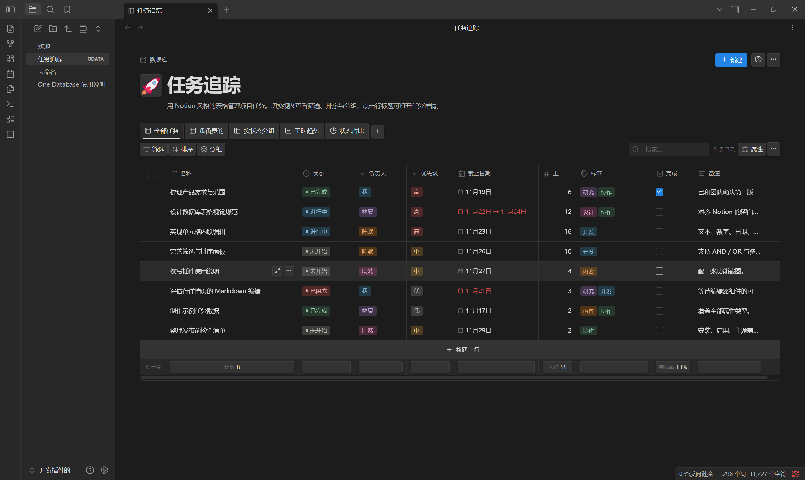
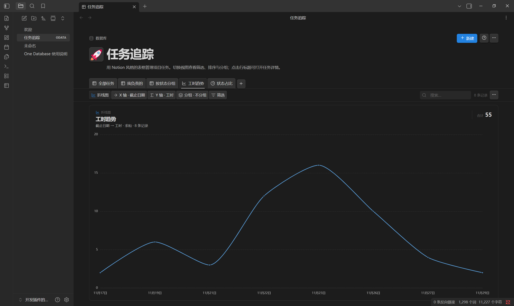
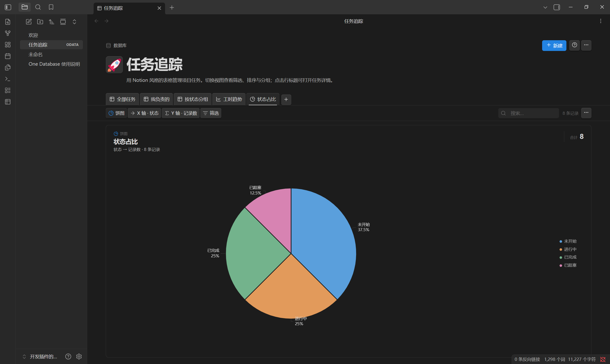

# One Database for Obsidian

一个以 Notion 数据库为灵感的 Obsidian 插件，支持表格、折线图和饼图视图。每个 `.odata` 文件就是一个数据库，数据以可读 JSON 保存在仓库内。

## 功能

- Notion 风格的全页数据库：图标、标题、描述、视图标签、筛选、排序、搜索、分组。
- 属性类型：标题、文本、数字（数字 / 千分位 / 百分比 / 人民币）、单选、多选、状态、日期、复选框、网址、邮箱、创建时间、最后编辑时间。
- Notion 风格的内联编辑：点击单元格编辑，标签可即时创建，支持日期范围与时间，表头可拖拽调整列宽。
- 每个视图独立保存筛选、排序、搜索、隐藏属性、分组与底部计算。
- 折线图与饼图：按需引入 ECharts，只打包折线图、饼图和必要组件；支持分类轴、数值聚合、日期粒度、按属性拆分线条。
- 行详情页：图标、标题、全部属性、页面正文；支持删除记录。
- 批量选择、复制行、插入行、删除行、导出当前视图为 CSV。
- 表格视图支持无限滚动：默认每次加载 500 条记录，滚动到底部自动加载下一批；可在「设置 → 第三方插件 → One Database」中调整每次加载的数据量，把输入框清空则关闭无限滚动、一次性加载全部数据。
- 深色 / 浅色主题适配。

## 预览







## 使用

1. 点击左侧工具栏的表格图标，或执行命令「新建 One Database 表格」。
2. 也可以在任意文件夹右键 →「新建 One Database」。
3. 打开生成的 `.odata` 文件开始编辑；数据库会自动保存。
4. 点击视图标签右侧的「＋」，可以新建表格、折线图或饼图视图。
5. 点击右上角「?」查看插件内帮助。
6. 表格视图默认每次加载 500 条记录，滑到底部继续加载；在「设置 → 第三方插件 → One Database」里可以修改每次加载的数据量，清空输入框即可一次性加载全部记录。

示例数据库：`任务追踪.odata`，包含「工时趋势」折线图和「状态占比」饼图。

## 开发

```bash
npm install
npm run build
```

构建产物为 `main.js`，样式为 `styles.css`，Obsidian 直接加载两者。源码位于 `src/`。

图表使用 `echarts/core` + `LineChart` + `PieChart` + `CanvasRenderer` + `Grid` / `Tooltip` / `Legend` 组件按需构建，不引入完整 ECharts。生产构建会开启压缩。

> 注意：同一个数据库同时打开多个标签页编辑时，后保存的版本会覆盖先保存的版本。插件的数据文件是纯文本，建议用 Git 或同步盘保留历史。
